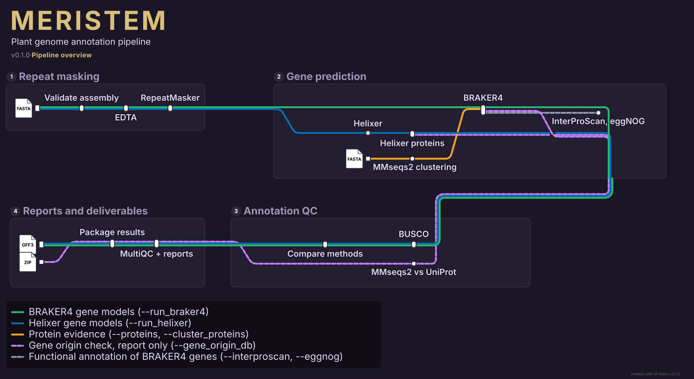

# Meristem

<!-- badges: start -->
[](https://github.com/Gian77/Meristem)
[](https://github.com/Gian77/Meristem/releases)
[](https://github.com/Gian77/Meristem/issues)
<!-- badges: end -->

<p align="center">
  
</p>

`Meristem` is a [Nextflow](https://www.nextflow.io/) pipeline for structural annotation of plant
genomes. It discovers and soft-masks repeats, predicts genes with two independent methods, BRAKER4
(protein evidence) and Helixer (deep learning), and compares them on gene counts and BUSCO completeness.
An optional check reports genes that look foreign, such as bacterial genes left on unfiltered contigs.
It was developed on sorghum genomes assembled with [Canopy](https://github.com/Gian77/Canopy) and is
still under active development. A **meristem** is the growing tissue of a plant, where new cells are
made and become organs, much like gene models taking shape on an assembled genome.

## Contents

- [Contact](#contact)
- [What Meristem does](#what-meristem-does)
- [Workflow DAG](#workflow-dag)
- [Key parameters](#key-parameters)
- [Directory structure expected](#directory-structure-expected)
- [Setup](#setup)
- [Running](#running)
- [Results](#results)
- [Reproducibility](#reproducibility)
- [Gene origin check](#gene-origin-check)
- [Using Meristem on another species](#using-meristem-on-another-species)
- [Resource classes](#resource-classes-configured-in-nextflowconfig)
- [HPC notes](#hpc-notes-glbrc--htcondor)
- [Containers](#containers)
- [Known limitations](#known-limitations)
- [Clean up](#clean-up)
- [References](#references)

## Contact

Gian M. N. Benucci, Ph.D. — [benucci@msu.edu](mailto:benucci@msu.edu) — Michigan State University

## What Meristem does

For each assembly in the samplesheet:

**Repeat masking**

1. **Assembly check:** the FASTA must be non-empty. Sequence count, total length, N50 and gap bases are
   recorded for sequences of at least `--min_contig_size` (5 kb). Nothing is removed.
2. **Repeat discovery:** EDTA builds a transposable element library for the genome (`--step all`,
   `--anno 1`). EDTA needs short sequence names, so contigs are renamed `ctg000000001`, `ctg000000002`
   and so on, and every later file uses those names. `repeats/edta/<sample>.edta_id_map.tsv` maps them
   back to the original names.
3. **Soft masking:** RepeatMasker masks the genome with that library in lower case (`-xsmall`).

**Gene prediction**

4. **Protein evidence (BRAKER4 only):** the `--proteins` FASTA, optionally reduced first with MMseqs2
   `easy-linclust` (`--cluster_proteins`).
5. **BRAKER4:** the published BRAKER4 Snakemake workflow, run unmodified at a pinned commit, in protein
   evidence (EP) mode on the soft-masked genome: GeneMark-EP+ and ProtHint train AUGUSTUS, and TSEBRA
   combines the predictions. Its internal compleasm step uses `--braker4_busco_lineage` (odb12). Contigs
   shorter than `--braker4_min_contig` (10 kb) are not annotated. Gene IDs get the sample name
   (`<sample>_g1`), so they stay unique across genomes. Meristem stops the run if compleasm failed inside
   BRAKER4 (see [Reproducibility](#reproducibility)).
6. **Helixer:** ab initio prediction with the `land_plant` model. It needs no evidence. Its proteins are
   then translated from the gene models and the soft-masked genome.
7. **Functional annotation (optional):** InterProScan (`--interproscan`) and eggNOG-mapper (`--eggnog`)
   on the BRAKER4 proteins.

**Annotation QC**

8. **BUSCO:** each method's proteins against `--busco_lineage` (odb10), offline from `--busco_db`.
9. **Comparison:** gene, mRNA, exon and CDS counts, and BUSCO, side by side, when both methods run.
10. **Gene origin check (optional, report only):** MMseqs2 searches each method's proteins against a
    UniProt FASTA, and each contig is called from the taxonomy of its genes' best hits. See
    [Gene origin check](#gene-origin-check).

**Reports and deliverables**

11. **Reports:** per-method summaries, an analysis report (HTML, Markdown, DOCX and PDF) and MultiQC when
    both methods run with `--busco_db`, a tools guide, and a run manifest that records exactly what was
    used.
12. **Deliverables:** after a successful run, two dated ZIP archives, one with every published file and
    one with the annotations and their QC.

## Workflow DAG

<p align="center">
  
</p>

Each line follows one kind of data through the stations that process it, and dashed lines are optional.
The map simplifies some details:

- Both prediction lines carry the soft-masked genome from RepeatMasker. BRAKER4 also takes the protein
  evidence (orange), which is clustered only with `--cluster_proteins`.
- With `--run_edta false`, the EDTA station is skipped and RepeatMasker uses `--repeatmasker_library`.
- Comparing methods, MultiQC and the full analysis report need both methods and `--busco_db`. A run with
  one method still gets BUSCO and that method's own report.
- The gene origin check (purple) runs only with `--gene_origin_db` and changes nothing in the
  annotation.

For the full process-level graph of a run, open `pipeline_info/dag.html` in its output directory.

The map is drawn with [nf-metro](https://github.com/seqeralabs/nf-metro) from
[`docs/images/meristem_metro.mmd`](docs/images/meristem_metro.mmd). After changing the workflow, update
that file and render it again. nf-metro draws only a one-line title, so a second command adds the
Meristem header (name in the logo colours, description, and the version from `manifest.version` in
`nextflow.config`):

```bash
pip install nf-metro==2.1.0   # needs Python 3.10 or later
nf-metro render docs/images/meristem_metro.mmd --embed-font --font-scale 1.3 --x-spacing 95 \
  --section-x-gap 30 -o docs/images/meristem_metro.svg
python3 docs/images/metro_header.py docs/images/meristem_metro.svg nextflow.config
```

## Key parameters

### Inputs and general

| Parameter | Default | Notes |
|---|---|---|
| `--input` | required | CSV with `sample,assembly` columns. Sample names must be unique |
| `--outdir` | `results` | Output directory |
| `--proteins` | required for BRAKER4 | Protein evidence FASTA with unique, simple IDs |
| `--busco_db` | none | Folder holding `lineages/<lineage>/`. Required for BRAKER4, and for BUSCO and the comparison report |
| `--busco_lineage` | `poales_odb10` | Lineage for the reported BUSCO scores |
| `--min_contig_size` | `5000` | Only affects the assembly statistics |

### Repeats

| Parameter | Default | Notes |
|---|---|---|
| `--run_edta` | `true` | Discover a repeat library per genome |
| `--edta_species` | `others` | EDTA `--species`: `Rice`, `Maize` or `others` |
| `--run_repeatmasker` | `true` | Soft-mask the genome |
| `--repeatmasker_library` | none | Existing repeat library, used when `--run_edta false` |
| `--edta_db` | none | Alternative to `--repeatmasker_library` with `--run_edta false` |

### BRAKER4

| Parameter | Default | Notes |
|---|---|---|
| `--run_braker4` | `true` | Run BRAKER4 |
| `--braker4_source` | `vendor/BRAKER4-6a5ee16` | BRAKER4 folder installed by `scripts/setup_braker4.sh` |
| `--braker4_commit` | `6a5ee16591a0…` | The tested BRAKER4 commit. The run stops if `--braker4_source` is another version |
| `--braker4_allow_unpinned` | `false` | Run with a BRAKER4 folder that is not the tested commit |
| `--braker4_busco_lineage` | `poales_odb12` | odb12 lineage used inside BRAKER4. Must exist in `<busco_db>/lineages/` |
| `--braker4_snakemake` | `.snakemake-env/bin/snakemake` | Snakemake that drives BRAKER4 |
| `--braker4_braker3_image` | `docker://teambraker/braker3:v3.1.1` | Container with AUGUSTUS, GeneMark, ProtHint, TSEBRA and compleasm |
| `--braker4_singularity_prefix` | `.apptainer_cache` | Cache for BRAKER4's own containers |
| `--braker4_singularity_args` | `-B <Meristem folder>` | Bind paths for BRAKER4's containers. `--busco_db` is added automatically |
| `--braker4_min_contig` | `10000` | Contigs shorter than this get no BRAKER4 genes |
| `--cluster_proteins` | `false` | Cluster the protein evidence first |
| `--cluster_min_seq_id` | `0.90` | MMseqs2 minimum identity. 0.80 is faster but can drop useful divergent homologs |
| `--cluster_coverage` | `0.80` | MMseqs2 minimum target coverage |

### Helixer

| Parameter | Default | Notes |
|---|---|---|
| `--run_helixer` | `false` | Run Helixer. The Condor launcher turns it on |
| `--helixer_model` | `helixer_models/land_plant/land_plant_v0.3_a_0080.h5` | Local model file. See [Setup](#setup) |
| `--helixer_lineage` | `land_plant` | `land_plant`, `vertebrate`, `invertebrate` or `fungi` |
| `--helixer_container` | `docker://gglyptodon/helixer-docker:helixer_v0.3.7_cuda_12.2.2-cudnn8_1` | A local `.sif` path also works |
| `--helixer_container_options` | `""` | `--nv` to use an NVIDIA GPU. Without it Helixer runs on CPU |
| `--helixer_deterministic` | `false` | Helixer's `--deterministic`. Off, so reruns can differ slightly |

### Gene origin and functional annotation

| Parameter | Default | Notes |
|---|---|---|
| `--gene_origin_db` | none | Protein FASTA with `OX=` taxon IDs in the headers, such as UniProt Swiss-Prot. Turns the check on |
| `--gene_origin_taxonomy` | none | NCBI `nodes.dmp`. Required with `--gene_origin_db` |
| `--interproscan` | `false` | InterProScan on BRAKER4 proteins. Needs `--interproscan_db` |
| `--eggnog` | `false` | eggNOG-mapper on BRAKER4 proteins. Needs `--eggnog_db` |

### Resources and output

| Parameter | Default | Notes |
|---|---|---|
| `--max_cpus`, `--max_memory`, `--max_time` | `48`, `768.GB`, `7.day` | Recorded in the manifest. Per-process requests are set by [labels](#resource-classes-configured-in-nextflowconfig) |
| `--publish_dir_mode` | `copy` | How results are written to `--outdir` |

## Directory structure expected

You provide the assemblies and `databases/`. `scripts/setup_braker4.sh` creates the BRAKER4 folder and
the Snakemake environment. The other files come with the repository.

```text
Meristem/
├── main.nf                       # entry point: input checks, provenance, run manifest
├── nextflow.config               # parameters, resource labels and profiles
├── nextflow_schema.json          # parameter descriptions
├── workflows/annotation.nf       # the annotation workflow
├── modules/local/                # one file per step: EDTA, RepeatMasker, BRAKER4, Helixer, BUSCO, ...
├── scripts/
│   ├── setup_braker4.sh          # installs the pinned BRAKER4 and its Snakemake environment
│   ├── summarize_gene_origin.py  # gene origin calls and report
│   ├── render_annotation_reports.py  # HTML, Markdown, DOCX and PDF reports
│   ├── package_deliverables.py   # dated ZIP archives
│   ├── resolve_resume_session.sh # finds the Nextflow session of a run to resume
│   └── monitor_condor_job.sh     # follows a Condor head job
├── bin/condor_submit             # routes task submissions to the scheduler
├── run_annotation.submit         # HTCondor submit file for the Nextflow head job
├── run_annotation_condor.sh      # script that the head job runs
├── conf/test.config              # small local settings for stub tests
├── tests/                        # stub validation, unit tests and the Col-0 test
├── docs/images/                  # workflow metro map and its source
├── logo/
├── requirements-snakemake.txt    # pinned Snakemake for BRAKER4
├── vendor/BRAKER4-6a5ee16/       # created by setup_braker4.sh (not in git)
├── .snakemake-env/               # created by setup_braker4.sh (not in git)
├── helixer_models/land_plant/    # you download (not in git)
└── databases/                    # you provide (not in git)
    ├── plant_annotation/ensembl_plants_release63/processed/poales_reference_proteins.faa
    └── busco_downloads/lineages/
        ├── poales_odb10/         # reported BUSCO
        └── poales_odb12/         # used inside BRAKER4
```

The samplesheet can point to assemblies anywhere:

```csv
sample,assembly
F25101,/path/to/F25101_final.fasta
F10702,/path/to/F10702_final.fasta
```

Use absolute paths: a relative path is read from the directory Nextflow is launched in.

## Setup

### Create the Nextflow conda environment

Meristem needs Nextflow, Java and Apptainer. Every tool except the BRAKER4 driver runs in a container:

```bash
conda create -n nextflow -c conda-forge -c bioconda \
    nextflow=26.04.1 apptainer=1.4.5 openjdk=21
conda activate nextflow

nextflow -version
apptainer --version
```

These are the versions the current results were produced with. `nextflow.config` allows Nextflow 24.04.0
or later, but older versions have not been tested. The Condor launcher expects the environment at
`~/.conda/envs/nextflow` and does not need it activated.

### Install BRAKER4

Meristem runs BRAKER4 exactly as published, fixed at commit `6a5ee16` (22 September 2026), and never
downloads it during a run. Install it once:

```bash
scripts/setup_braker4.sh
```

This downloads that commit from GitHub into `vendor/BRAKER4-6a5ee16/`, writes
`MERISTEM_BRAKER4_SOURCE.txt` there to record the version, and builds `.snakemake-env/` with the
Snakemake version in `requirements-snakemake.txt`. Building the environment needs Python 3.11 or later;
set `PYTHON=/path/to/python3.11` if the default `python3` is older. Both folders can go elsewhere:

```bash
scripts/setup_braker4.sh /shared/tools/BRAKER4-6a5ee16 /shared/tools/snakemake-env
# then run with --braker4_source /shared/tools/BRAKER4-6a5ee16 \
#              --braker4_snakemake /shared/tools/snakemake-env/bin/snakemake
```

The script reuses folders it installed before and refuses to write into any other existing folder.

### Download the Helixer model

```bash
apptainer exec docker://gglyptodon/helixer-docker:helixer_v0.3.7_cuda_12.2.2-cudnn8_1 \
    fetch_helixer_models.py --lineage land_plant --custom-path helixer_models
```

The default `--helixer_model` is `helixer_models/land_plant/land_plant_v0.3_a_0080.h5`. Its md5 is
recorded in each run manifest.

### Protein evidence

BRAKER4 uses the proteins of related species. For sorghum, Meristem uses all proteins of four grasses
from Ensembl Plants release 63 (203,254 proteins). Each header becomes `>species|protein_id`:

```bash
REL=https://ftp.ebi.ac.uk/ensemblgenomes/pub/release-63/plants/fasta
OUT=databases/plant_annotation/ensembl_plants_release63
mkdir -p "$OUT/raw" "$OUT/processed"
for f in sorghum_bicolor/pep/Sorghum_bicolor.Sorghum_bicolor_NCBIv3.pep.all.fa.gz \
         zea_mays/pep/Zea_mays.Zm-B73-REFERENCE-NAM-5.0.pep.all.fa.gz \
         setaria_italica/pep/Setaria_italica.Setaria_italica_v2.0.pep.all.fa.gz \
         oryza_sativa/pep/Oryza_sativa.IRGSP-1.0.pep.all.fa.gz; do
    sp=${f%%/*}
    curl -fsSL -o "$OUT/raw/$sp.pep.all.fa.gz" "$REL/$f"
    zcat "$OUT/raw/$sp.pep.all.fa.gz" \
        | awk -v sp="$sp" '/^>/ { split(substr($1, 2), a, " "); print ">" sp "|" a[1]; next } { print }'
done > "$OUT/processed/poales_reference_proteins.faa"
md5sum "$OUT/processed/poales_reference_proteins.faa"
```

Record the checksums of the downloads next to them; ours are in `MANIFEST.tsv` in that folder. For
another plant group, choose species from the same order (see
[Using Meristem on another species](#using-meristem-on-another-species)).

### BUSCO lineages

Two versions of the same lineage are needed: odb10 for the reported scores, comparable with Canopy and
with published plant genomes, and odb12 for BRAKER4, which is built for it. Download them with the
checksums listed in [`file_versions.tsv`](https://busco-data.ezlab.org/v5/data/file_versions.tsv):

```bash
mkdir -p databases/busco_downloads/lineages && cd databases/busco_downloads/lineages
for f in poales_odb10.2024-01-08 poales_odb12.2026-05-22; do
    curl -fsSLO "https://busco-data.ezlab.org/v5/data/lineages/$f.tar.gz"
    md5sum "$f.tar.gz"     # compare with file_versions.tsv
    tar -xzf "$f.tar.gz"
done
```

### Gene origin databases (optional)

The check needs a protein FASTA whose headers carry `OX=<taxon id>`, such as
[UniProt Swiss-Prot](https://www.uniprot.org/help/downloads), and NCBI's `nodes.dmp` from
[taxdump](https://ftp.ncbi.nlm.nih.gov/pub/taxonomy/). Both are read-only inputs.

## Running

### Check the setup

```bash
# Check that the configuration parses
nextflow config -profile condor

# Run every step as a stub, without tools or data
tests/run_validation_cases.sh
```

`run_validation_cases.sh` runs a five-sample stub, the gene origin stub, and five inputs that must be
rejected. It launches Nextflow from the repository folder, so it adds entries to that folder's Nextflow
history. Python unit tests for the report and gene origin scripts:

```bash
python3 -m unittest discover -s tests -p 'test_*.py'
```

### One run with your own options

On HTCondor, from the submit node, with both methods:

```bash
nextflow run main.nf \
    -profile condor \
    --input samplesheet.csv \
    --proteins databases/plant_annotation/ensembl_plants_release63/processed/poales_reference_proteins.faa \
    --busco_db databases/busco_downloads \
    --busco_lineage poales_odb10 \
    --braker4_busco_lineage poales_odb12 \
    --run_helixer true \
    --cluster_proteins true --cluster_min_seq_id 0.80 --cluster_coverage 0.80 \
    --outdir results/my_run \
    -w nf-work-my_run \
    -resume
```

Without `-profile condor`, tasks run on the local machine with the same resource requests, so EDTA alone
asks for 48 CPUs and 768 GB of RAM. To add the gene origin check:

```bash
    --gene_origin_db /path/to/uniprot_sprot.fasta \
    --gene_origin_taxonomy /path/to/nodes.dmp
```

To run one method only, set `--run_braker4 false` or leave `--run_helixer` at `false`.

### All samples on HTCondor

`run_annotation.submit` starts the Nextflow head job on the submit node (`universe = local`), and that job
submits every task to the cluster. Edit `RUN_NAME`, `INPUT`, `OUTDIR`, `WORKDIR`, `PROTEINS` and
`BUSCO_DB` at its top, add `NEW_RUN=true` to its `environment` line for a first run, and submit:

```bash
mkdir -p condor_logs
condor_submit run_annotation.submit
condor_q
```

The submit file runs both methods with protein clustering at 80% identity and 80% coverage. The script it
starts, `run_annotation_condor.sh`, turns on the gene origin check with the GLBRC shared databases and
reads these environment variables, which the submit file's `environment` line sets:

| Variable | Default | Effect |
|---|---|---|
| `INPUT`, `OUTDIR`, `WORKDIR` | F10702 paths | Samplesheet, results and work directory |
| `PROTEINS`, `BUSCO_DB` | required | Protein evidence and BUSCO folder |
| `BUSCO_LINEAGE` | `poales_odb10` | Reported BUSCO lineage |
| `BRAKER4_BUSCO_LINEAGE` | `poales_odb12` | Lineage inside BRAKER4 |
| `BRAKER4_SOURCE` | config default | Another BRAKER4 folder |
| `RUN_BRAKER4`, `RUN_HELIXER` | `true`, `false` | Methods to run |
| `HELIXER_MODEL` | config default | Another Helixer model |
| `CLUSTER_PROTEINS`, `CLUSTER_MIN_SEQ_ID`, `CLUSTER_COVERAGE` | `false`, `0.90`, `0.80` | Protein clustering |
| `RUN_GENE_ORIGIN` | `true` | Gene origin check. `GENE_ORIGIN_DB` and `GENE_ORIGIN_TAXONOMY` override its files |
| `NEW_RUN` | `false` | Start a new session. Without it, a run with no recorded session stops |
| `RESUME_SESSION` | none | Resume a specific Nextflow session |

The launcher contains paths specific to our setup (`HOME`, the conda environment, the shared databases).
Update them before using it elsewhere.

### Follow and stop a run

```bash
tail -f condor_logs/<RUN_NAME>.stdout.txt
scripts/monitor_condor_job.sh <cluster_id> 600 | tee condor_logs/monitor.log   # status every 10 min
condor_rm <cluster_id>                                                           # stops the head job
```

`scripts/monitor_condor_job.sh` stops when the job completes, is held or is removed. For a monitor that
keeps running after you log out, submit `monitor_condor_job.submit` with `-append "JOB_ID=<cluster_id>"`.

### Resume after a failure

Submit the same file again. The launcher finds the session recorded for its own `OUTDIR` and `WORKDIR`
and resumes it, including after a Condor eviction, so Nextflow reruns only what changed or failed. With
your own commands, add `-resume` and keep the same `-w` directory.

Launch Nextflow from a dedicated directory, and pass the absolute path to `main.nf`. A bare `-resume`
picks up the last session launched in the current directory, which may belong to another run.

### Test on *Arabidopsis* Col-0

Col-0 has an expert reference annotation, so this test measures how accurate the gene models are, not
only BUSCO completeness. Rerun it after changing the workflow:

```bash
condor_submit tests/col0_test.submit
```

It annotates the Canopy Col-0 assembly with Brassicales proteins from Ensembl Plants release 63
(*A. thaliana*, *A. lyrata*, *B. rapa*, *B. oleracea*), `brassicales_odb10` for the reported BUSCO and
`brassicales_odb12` inside BRAKER4. The test data are kept in `databases/test_col0/`, with the
Ensembl TAIR10 release 63 GFF3 as the reference. Change `RUN_NAME` for each new test. The evidence
includes *A. thaliana* itself, as the sorghum evidence includes sorghum, so BRAKER4 accuracy on this test
is optimistic.

Score the finished run against the reference annotation (about 5 minutes on 4 CPUs):

```bash
tests/score_col0.sh results/<RUN_NAME>
```

The script keeps the reference's protein-coding genes on chromosomes 1-5, lifts them onto the Col-0
assembly with Liftoff 1.6.3 (the assembly's coordinates differ from TAIR10), and compares coding
structure (CDS only, UTRs ignored) with gffcompare 0.12.10. It writes `results/<RUN_NAME>/scoring/` and
does not change the run's other outputs. It is a standalone check, not a pipeline step.

Results of `Col0-test-20261112` (BRAKER4 `6a5ee16`, Helixer `land_plant_v0.3_a_0080`), against 27,284 of 27,420
reference genes that Liftoff placed:

| Level (sensitivity / precision, %) | BRAKER4 | Helixer |
|---|---:|---:|
| Base | 95.8 / 88.4 | 95.6 / 95.3 |
| Exon | 86.0 / 86.0 | 83.2 / 89.8 |
| Intron | 91.1 / 89.9 | 87.9 / 90.6 |
| Locus (one transcript with every coding exon exact) | 84.4 / 73.4 | 76.0 / 75.9 |
| Predicted loci overlapping no reference gene | 6,116 of 31,227 | 1,864 of 27,320 |

BRAKER4 finds more reference genes exactly, but about one prediction in five overlaps no reference gene.
1,817 of them are on small unplaced contigs where the reference has almost no genes. Helixer predicts fewer
spurious genes, with one transcript per gene. Transcript-level scores are low for both because the
reference has 39,938 isoforms and neither method predicts most alternative ones.

## Results

| Path | Contents |
|---|---|
| `assembly_qc/` | `<sample>.assembly.tsv`: sequence count, length, N50, gap bases |
| `repeats/edta/` | EDTA library (`.EDTA.TElib.fa`), repeat annotation (`.EDTA.TEanno.gff3`), renamed genome and `<sample>.edta_id_map.tsv` |
| `repeats/masked/` | Soft-masked genome (`<sample>.softmasked.fa`) and RepeatMasker output |
| `gene_prediction/braker4/` | `<sample>.braker4.gff3`, `.proteins.faa`, `.codingseq.fna`, the BRAKER4 log and `<sample>.braker4.compleasm.txt` |
| `gene_prediction/helixer/` | `<sample>.helixer.gff3`, `.proteins.faa`, `.codingseq.fna` and the Helixer log |
| `busco_comparison/` | BUSCO for each method and `<sample>.busco_annotation_comparison.tsv` |
| `comparison/` | `<sample>.annotation_comparison.tsv`: feature counts by method |
| `gene_origin/` | `<sample>.<method>.gene_origin.tsv` (one row per contig) and `.md` (summary) |
| `functional/` | InterProScan and eggNOG-mapper results, when selected |
| `reports/<sample>/` | Per-method summaries and manifests, `<sample>_analysis_report.html`, interpretation, DOCX and PDF, MultiQC, and a ZIP of all of them |
| `reports/pipeline_tools/` | Tools guide: purpose, inputs, outputs and limits of each tool |
| `pipeline_info/` | `RUN_STATUS.md`, `RUN_MANIFEST.md`, `PIPELINE_SOURCE.sha256`, Nextflow report, timeline, trace and DAG |
| `deliverables/` | `meristem_results_DD-MM-YYYY.zip` (everything published) and `meristem_annotations_DD-MM-YYYY.zip` (annotations and their QC), each with its own `README.md` |

**Sequence names:** the GFF3 and FASTA files use EDTA's `ctg000000001` names, not the assembly's. Use
`repeats/edta/<sample>.edta_id_map.tsv` to translate them. Gene IDs carry the sample name in both
methods (`<sample>_g1` for BRAKER4, `<sample>_ctg000000001_000001` for Helixer).

The HTML reports are self-contained and readable offline, and they print to PDF from a browser. The
deliverables archives leave out the input assemblies and shared databases, and a failed run gets none.

As a guide, F25101 (about 665 Mb) took 33 hours on our cluster: EDTA 23 h, RepeatMasker 3 h, BRAKER4
6.5 h, Helixer 4 h on CPU, and BUSCO 15 min per method. It produced 8 GB of results, 5.6 GB of it in the
two archives, and 20 GB of work directory.

## Reproducibility

Each run records what it used in `pipeline_info/RUN_MANIFEST.md`, under **Provenance**:

- **Meristem commit**, read from `.git/HEAD`. Meristem never runs git commands.
- **Meristem source digest**, a checksum of `PIPELINE_SOURCE.sha256`, which lists a sha256 for every
  pipeline file. To find out whether a run used edited, uncommitted code, run `sha256sum -c` on that file
  from a clean checkout of the recorded commit: any file that fails was changed.
- **BRAKER4 commit** and its install record. If `--braker4_source` is not the tested commit, the run stops
  at launch unless `--braker4_allow_unpinned true` is set.
- **Helixer model md5**, and the md5 of every **input assembly**.

The manifest also lists every parameter, so container tags and database paths are recorded too. Tool
versions are fixed by those container tags, and BRAKER4's own tool versions are in its results
(`software_versions.tsv` in the BRAKER4 task directory).

**BRAKER4 and BUSCO versions.** BRAKER4 is built for odb12, and its compleasm step mishandles odb10 gene
names. With odb10 it crashes in protein mode and reports every gene as missing in genome mode. BRAKER4
ignores compleasm errors, so such a run looks normal but has lost a source of gene hints and its BUSCO
rescue step. Meristem therefore gives BRAKER4 an odb12 lineage, and after BRAKER4 finishes it stops the
run if compleasm made no BUSCO hints, wrote no summary, or the rescue step failed. The reported BUSCO
scores stay on odb10 with BUSCO 5.8.0, so they remain comparable with Canopy's assembly scores and with
published genomes.

**What can still differ between reruns:** Helixer is not run in deterministic mode (a deliberate choice),
so its gene models can differ slightly between runs.

## Gene origin check

Assembly filtering can leave foreign contigs in a genome, and BUSCO does not detect added foreign genes.
In one earlier sorghum annotation, 10,950 of 36,663 BRAKER4 genes sat on bacterial contigs. This
optional check runs after gene prediction:

1. MMseqs2 searches each method's proteins against `--gene_origin_db` (E-value 1e-5, best 5 hits).
2. Each best hit is placed in a group (plant, bacteria, archaea, fungi, animal, other eukaryote, virus)
   using `--gene_origin_taxonomy`.
3. Each contig with genes is called from its hits. With fewer than 3 hits it is `too_few_hits`. Otherwise
   it is `bacterial_like` when at least half of its hits are prokaryotic (bacteria or archaea),
   `plant_like` when at least half are Viridiplantae, and `mixed` when neither holds. Contigs without
   genes are `no_genes`.

Nothing is removed from the annotation or the assembly. The report lists the contigs to review and how
many genes would remain without them. A best hit is evidence, not proof: conserved proteins can have a
bacterial best hit in clean plant sequence, so check whether such genes cluster on a few contigs before
treating them as contamination. Swiss-Prot is small, so many plant genes have no hit at all.

Direct `nextflow run` commands leave the check off. `run_annotation_condor.sh` turns it on with the GLBRC
copies of Swiss-Prot and the PlusPFP `nodes.dmp`; set `RUN_GENE_ORIGIN=false` to skip it.

## Using Meristem on another species

Meristem has been used on sorghum and is being tested on *Arabidopsis*. For another plant, check at
least these:

| Setting | Why |
|---|---|
| `--proteins` | Proteins of several species from the same order, ideally including close relatives |
| `--busco_lineage`, `--braker4_busco_lineage` | The odb10 and odb12 versions of a lineage that matches your species, both in `--busco_db` |
| `--helixer_lineage`, `--helixer_model` | `land_plant` for plants |
| `--edta_species` | `Rice` or `Maize` use EDTA's curated libraries; anything else uses `others` |
| `--braker4_min_contig` | Lower it for fragmented assemblies, where many genes sit on contigs under 10 kb |
| `--gene_origin_taxonomy` | The plant group in the report is Viridiplantae; other kingdoms need changes to `scripts/summarize_gene_origin.py` |

## Resource classes (configured in nextflow.config)

A **label** is a named resource class. Each process declares one, and the matching `withLabel:` block in
`nextflow.config` sets the CPUs, memory and time Nextflow requests for it.

| Label | CPUs | RAM | Time | Used by |
|---|---:|---:|---:|---|
| `low` | 2 | 4 GB | 4 h | Assembly check, comparisons, reports, gene origin report |
| `repeat_discovery` | 48 | 768 GB | 7 d | EDTA |
| `repeat_masking` | 16 | 32 GB | 2 d | RepeatMasker |
| `braker4` | 32 | 96 GB | 7 d | BRAKER4 (all of its steps run inside this one task) |
| `helixer` | 16 | 64 GB | 2 d | Helixer |
| `protein_clustering` | 16 | 32 GB | 2 d | MMseqs2 clustering, gene origin search |
| `busco` | 8 | 32 GB | 2 d | BUSCO, Helixer protein translation |
| `functional` | 16 | 64 GB | 7 d | InterProScan, eggNOG-mapper |

- **EDTA memory:** the 768 GB request is deliberate. EDTA was the largest consumer on sorghum, and
  Nextflow reported a peak of 1.2 TB on F25101, which is probably summed over EDTA's subprocesses.
- **Failures:** `errorStrategy = 'finish'` lets running tasks complete after a failure, so long jobs are
  not lost, and the run still reports failure.
- **Parallel tasks:** at most 8 copies of a process run at once (`maxForks`).
- **Other clusters:** adjust these values to your queue limits.

## HPC notes (GLBRC / HTCondor)

Meristem was developed on the GLBRC `scarcity` HTCondor cluster, the only system it has been tested on.
Elsewhere, expect to change the executor profile, the node preferences in `nextflow.config`, the
launcher paths and `bin/condor_submit`.

- **Submit node:** the Nextflow head job runs on `scarcity-ap-1` (`universe = local`) and only dispatches
  work.
- **Scheduler routing:** `run_annotation_condor.sh` puts `bin/` first on `PATH`, so task submissions go
  through `bin/condor_submit` to `scarcity-ap-1.glbrc.org`. Set `MERISTEM_CONDOR_SCHEDD` for another
  scheduler.
- **Node preference:** tasks prefer `scarcity-12`, then `scarcity-9`, and can use any other eligible
  node. `scarcity-14` is excluded. Node availability is shown at
  [CRG Scarcity](https://crg.glbrc.org/#/scarcity).
- **Container cache:** with `-profile condor`, images are stored in `~/.apptainer_cache`. The first run
  downloads them all; the Helixer image alone is 3.4 GB.
- **BRAKER4's containers:** BRAKER4 pulls its own images into `--braker4_singularity_prefix` and only sees
  the folders in `--braker4_singularity_args` plus `--busco_db`. Keep the genome, proteins and work
  directory under a bound path.
- **Helixer on GPU:** the Condor profile does not request GPUs, so Helixer runs on CPU. To use a GPU, add
  a GPU request to the `helixer` label and `--helixer_container_options '--nv'`.
- **Idle or held jobs:** start with `condor_q -better-analyze <job_id>`, then `condor_q -hold` and the job
  log. See the [HTCondor troubleshooting guide](https://htcondor.readthedocs.io/en/main/users-manual/troubleshooting.html).

## Containers

Every tool runs in a container pinned to an exact tag in `nextflow.config`. See
[References](#references) for the versions.

| Tool | Image |
|---|---|
| EDTA | `quay.io/biocontainers/edta:2.2.2--hdfd78af_1` |
| RepeatMasker | `quay.io/biocontainers/repeatmasker:4.1.5--pl5321hdfd78af_0` |
| MMseqs2 | `quay.io/biocontainers/mmseqs2:15.6f452--pl5321h6a68c12_3` |
| BRAKER4's tools | `docker://teambraker/braker3:v3.1.1`, pulled by BRAKER4 |
| Helixer | `docker://gglyptodon/helixer-docker:helixer_v0.3.7_cuda_12.2.2-cudnn8_1` (digest `sha256:ed798e84…`) |
| BUSCO | `quay.io/biocontainers/busco:5.8.0--pyhdfd78af_0` |
| MultiQC and reports | `quay.io/biocontainers/multiqc:1.25.1--pyhdfd78af_0` |
| InterProScan | `quay.io/biocontainers/interproscan:5.75-106.0--hdfd78af_0` |
| eggNOG-mapper | `quay.io/biocontainers/eggnog-mapper:2.1.12--pyhdfd78af_0` |

BRAKER4's Snakemake driver is the one part that runs outside a container, from the `.snakemake-env`
built by `setup_braker4.sh`. Verify an image on the compute nodes before changing a tag: an image can
exist and still fail on older CPUs. Canopy's README describes helper functions for finding and testing
BioContainers tags.

## Known limitations

- **Sequence names:** annotations use EDTA's `ctg…` names. Translate them with
  `<sample>.edta_id_map.tsv` before comparing with other files that use the assembly's names.
- **Short contigs:** BRAKER4 skips contigs under 10 kb, so a fragmented assembly loses genes there.
  Helixer annotates them.
- **Protein evidence only:** Meristem runs BRAKER4 in EP mode. RNA-seq and Iso-Seq evidence, which BRAKER4
  supports, are not wired in.
- **Full report needs both methods:** the comparison, MultiQC and the full analysis report need BRAKER4,
  Helixer and `--busco_db`.
- **Functional annotation:** InterProScan and eggNOG-mapper only run on BRAKER4 proteins.
- **Gene origin check is advisory:** it calls contigs from best hits and removes nothing.
- **Helixer reruns** can differ slightly, because deterministic mode is off.
- **BRAKER4 contig lengths:** BRAKER4 (including commit `6a5ee16`) counts each contig's length with line
  breaks included when it splits work for AUGUSTUS, so the lengths it passes are slightly too long. This
  is probably harmless. Meristem does not patch it, so that BRAKER4 runs exactly as published.
- **Tested species:** sorghum, and *Arabidopsis* Col-0 as a test.

## Clean up

**Delete carefully.** The work directories hold the Nextflow cache. After you remove them, the next run
starts from the beginning. Published results do not depend on them.

```bash
# Task directories and cache
rm -rf nf-work-*

# Nextflow session state in the launch directory
rm -rf .nextflow/
rm -f .nextflow.log*

# Published results: back up anything you want to keep first
rm -rf results/

# Container image cache
apptainer cache list -v
apptainer cache clean
```

Meristem itself never deletes files and never writes into `databases/` or the input assemblies.

## References

Please cite the tools you use. Versions are the ones pinned in `nextflow.config` and used for the current
results.

### Workflow and containers

| Tool | Version | Reference |
|---|---|---|
| Nextflow | 26.04.1 | Di Tommaso P, et al. Nextflow enables reproducible computational workflows. *Nat Biotechnol* 2017;35:316–319. [doi:10.1038/nbt.3820](https://doi.org/10.1038/nbt.3820) |
| Snakemake (BRAKER4 driver) | 8.18.2 | Mölder F, et al. Sustainable data analysis with Snakemake. *F1000Research* 2021;10:33. [doi:10.12688/f1000research.29032.2](https://doi.org/10.12688/f1000research.29032.2) |
| Apptainer (Singularity) | 1.4.5 | Kurtzer GM, et al. Singularity: Scientific containers for mobility of compute. *PLoS ONE* 2017;12:e0177459. [doi:10.1371/journal.pone.0177459](https://doi.org/10.1371/journal.pone.0177459) |
| BioContainers | | da Veiga Leprevost F, et al. BioContainers: an open-source and community-driven framework for software standardization. *Bioinformatics* 2017;33:2580–2582. [doi:10.1093/bioinformatics/btx192](https://doi.org/10.1093/bioinformatics/btx192) |
| nf-metro | 2.1.0 | Workflow map. <https://github.com/seqeralabs/nf-metro> |

### Repeats

| Tool | Version | Reference |
|---|---|---|
| EDTA | 2.2.2 | Ou S, et al. Benchmarking transposable element annotation methods for creation of a streamlined, comprehensive pipeline. *Genome Biol* 2019;20:275. [doi:10.1186/s13059-019-1905-y](https://doi.org/10.1186/s13059-019-1905-y) |
| RepeatMasker | 4.1.5 | Smit AFA, Hubley R, Green P. RepeatMasker Open-4.0. <https://www.repeatmasker.org> |

### Gene prediction

| Tool | Version | Reference |
|---|---|---|
| BRAKER4 | commit `6a5ee16` (0.5.0-beta) | Krall H, Hoff KJ. BRAKER4: a Snakemake pipeline for fully automated eukaryotic genome annotation. Unpublished, 2026. <https://github.com/Gaius-Augustus/BRAKER4> |
| BRAKER (EP mode) | | Brůna T, et al. BRAKER2: automatic eukaryotic genome annotation with GeneMark-EP+ and AUGUSTUS supported by a protein database. *NAR Genom Bioinform* 2021;3:lqaa108. [doi:10.1093/nargab/lqaa108](https://doi.org/10.1093/nargab/lqaa108). Gabriel L, et al. BRAKER3: fully automated genome annotation using RNA-seq and protein evidence with GeneMark-ETP, AUGUSTUS, and TSEBRA. *Genome Res* 2024;34:769–777. [doi:10.1101/gr.278090.123](https://doi.org/10.1101/gr.278090.123). Brůna T, Gabriel L, Hoff KJ. Navigating eukaryotic genome annotation pipelines: a route map to using BRAKER, Galba, and TSEBRA. *Methods Mol Biol* 2025;2935:67–107. [doi:10.1007/978-1-0716-4583-3_4](https://doi.org/10.1007/978-1-0716-4583-3_4) |
| AUGUSTUS | 3.5.0 | Stanke M, et al. Using native and syntenically mapped cDNA alignments to improve de novo gene finding. *Bioinformatics* 2008;24:637–644. [doi:10.1093/bioinformatics/btn013](https://doi.org/10.1093/bioinformatics/btn013) |
| GeneMark-ES | 4 | Lomsadze A, et al. Gene identification in novel eukaryotic genomes by self-training algorithm. *Nucleic Acids Res* 2005;33:6494–6506. [doi:10.1093/nar/gki937](https://doi.org/10.1093/nar/gki937) |
| GeneMark-EP+ and ProtHint | 4, 2.6.0 | Brůna T, Lomsadze A, Borodovsky M. GeneMark-EP+: eukaryotic gene prediction with self-training in the space of genes and proteins. *NAR Genom Bioinform* 2020;2:lqaa026. [doi:10.1093/nargab/lqaa026](https://doi.org/10.1093/nargab/lqaa026) |
| TSEBRA | commit `23ef205` | Gabriel L, et al. TSEBRA: transcript selector for BRAKER. *BMC Bioinformatics* 2021;22:566. [doi:10.1186/s12859-021-04482-0](https://doi.org/10.1186/s12859-021-04482-0) |
| DIAMOND | 2.0.15 | Buchfink B, Reuter K, Drost HG. Sensitive protein alignments at tree-of-life scale using DIAMOND. *Nat Methods* 2021;18:366–368. [doi:10.1038/s41592-021-01101-x](https://doi.org/10.1038/s41592-021-01101-x) |
| Spaln | 2.3.3f | Iwata H, Gotoh O. Benchmarking spliced alignment programs including Spaln2, an extended version of Spaln that incorporates additional species-specific features. *Nucleic Acids Res* 2012;40:e161. [doi:10.1093/nar/gks708](https://doi.org/10.1093/nar/gks708) |
| miniprot | 0.12 | Li H. Protein-to-genome alignment with miniprot. *Bioinformatics* 2023;39:btad014. [doi:10.1093/bioinformatics/btad014](https://doi.org/10.1093/bioinformatics/btad014) |
| compleasm | 0.2.8 | Huang N, Li H. compleasm: a faster and more accurate reimplementation of BUSCO. *Bioinformatics* 2023;39:btad595. [doi:10.1093/bioinformatics/btad595](https://doi.org/10.1093/bioinformatics/btad595) |
| AGAT | 1.4.1 | Dainat J. AGAT: Another Gff Analysis Toolkit. Zenodo. [doi:10.5281/zenodo.3552717](https://doi.org/10.5281/zenodo.3552717) |
| Helixer | 0.3.7 | Stiehler F, et al. Helixer: cross-species gene annotation of large eukaryotic genomes using deep learning. *Bioinformatics* 2021;36:5291–5298. [doi:10.1093/bioinformatics/btaa1044](https://doi.org/10.1093/bioinformatics/btaa1044). Holst F, et al. Helixer: ab initio prediction of primary eukaryotic gene models combining deep learning and a hidden Markov model. *Nat Methods* 2025;23:732–739. [doi:10.1038/s41592-025-02939-1](https://doi.org/10.1038/s41592-025-02939-1) |
| MMseqs2 | 15.6f452 | Steinegger M, Söding J. MMseqs2 enables sensitive protein sequence searching for the analysis of massive data sets. *Nat Biotechnol* 2017;35:1026–1028. [doi:10.1038/nbt.3988](https://doi.org/10.1038/nbt.3988). Steinegger M, Söding J. Clustering huge protein sequence sets in linear time. *Nat Commun* 2018;9:2542. [doi:10.1038/s41467-018-04964-5](https://doi.org/10.1038/s41467-018-04964-5) |

### QC, functional annotation and reports

| Tool | Version | Reference |
|---|---|---|
| BUSCO | 5.8.0 | Manni M, et al. BUSCO update: novel and streamlined workflows along with broader and deeper phylogenetic coverage for scoring of eukaryotic, prokaryotic, and viral genomes. *Mol Biol Evol* 2021;38:4647–4654. [doi:10.1093/molbev/msab199](https://doi.org/10.1093/molbev/msab199) |
| InterProScan | 5.75-106.0 | Jones P, et al. InterProScan 5: genome-scale protein function classification. *Bioinformatics* 2014;30:1236–1240. [doi:10.1093/bioinformatics/btu031](https://doi.org/10.1093/bioinformatics/btu031) |
| eggNOG-mapper | 2.1.12 | Cantalapiedra CP, et al. eggNOG-mapper v2: functional annotation, orthology assignments, and domain prediction at the metagenomic scale. *Mol Biol Evol* 2021;38:5825–5829. [doi:10.1093/molbev/msab293](https://doi.org/10.1093/molbev/msab293) |
| MultiQC | 1.25.1 | Ewels P, et al. MultiQC: summarize analysis results for multiple tools and samples in a single report. *Bioinformatics* 2016;32:3047–3048. [doi:10.1093/bioinformatics/btw354](https://doi.org/10.1093/bioinformatics/btw354) |

### Databases and references

| Resource | Version | Source |
|---|---|---|
| Ensembl Plants proteins | Release 63 | Yates AD, et al. Ensembl Genomes 2022: an expanding genome resource for non-vertebrates. *Nucleic Acids Res* 2022;50:D996–D1003. [doi:10.1093/nar/gkab1007](https://doi.org/10.1093/nar/gkab1007) |
| BUSCO lineages, odb10 | `poales_odb10` (2024-01-08) | Kriventseva EV, et al. OrthoDB v10: sampling the diversity of animal, plant, fungal, protist, bacterial and viral genomes for evolutionary and functional annotations of orthologs. *Nucleic Acids Res* 2019;47:D807–D811. [doi:10.1093/nar/gky1053](https://doi.org/10.1093/nar/gky1053) |
| BUSCO lineages, odb12 | `poales_odb12` (2026-05-22) | Tegenfeldt F, et al. OrthoDB and BUSCO update: annotation of orthologs with wider sampling of genomes. *Nucleic Acids Res* 2025;53:D516–D522. [doi:10.1093/nar/gkae987](https://doi.org/10.1093/nar/gkae987) |
| Helixer model | `land_plant_v0.3_a_0080` | Fetched with `fetch_helixer_models.py` |
| UniProt Swiss-Prot | Local copy | The UniProt Consortium. UniProt: the Universal Protein Knowledgebase in 2025. *Nucleic Acids Res* 2025;53:D609–D617. [doi:10.1093/nar/gkae1010](https://doi.org/10.1093/nar/gkae1010) |
| NCBI taxonomy | `nodes.dmp` from the PlusPFP build | <https://ftp.ncbi.nlm.nih.gov/pub/taxonomy/> |
| *Arabidopsis* reference annotation (Col-0 test) | Ensembl Plants release 63, TAIR10 | `Arabidopsis_thaliana.TAIR10.63.gff3.gz` |
